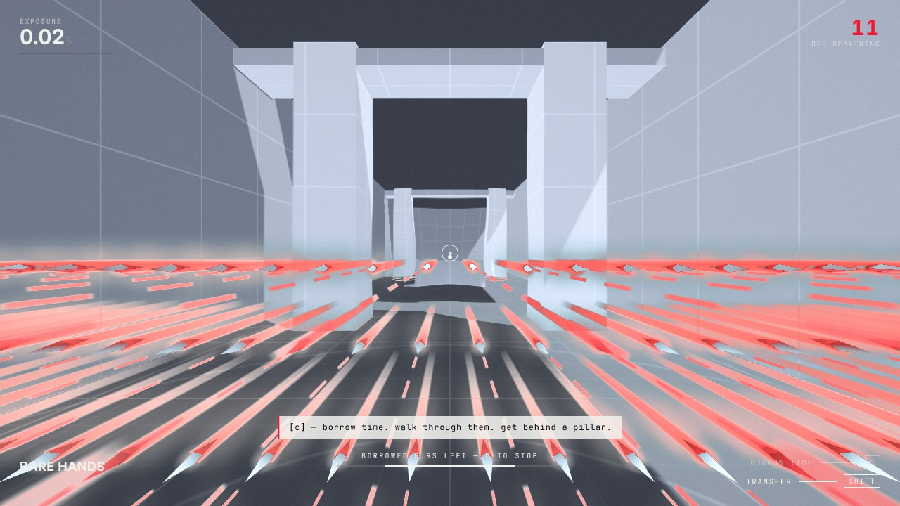
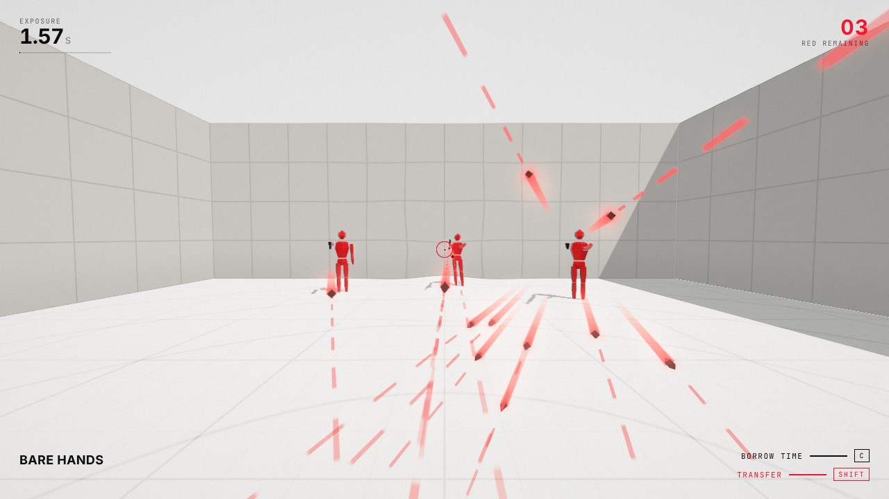
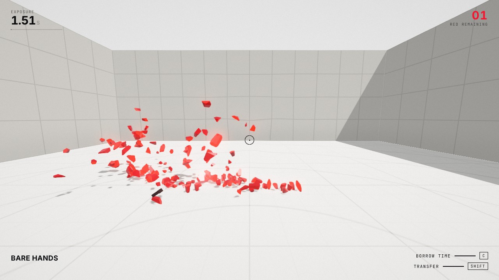
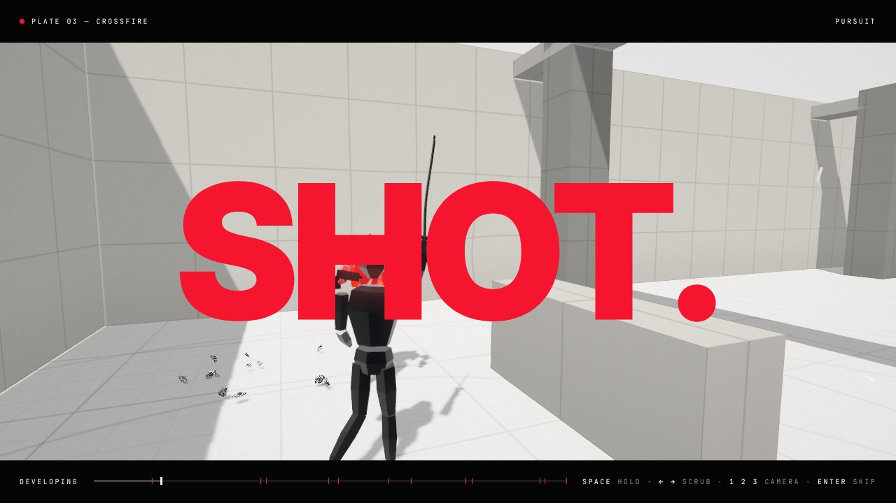
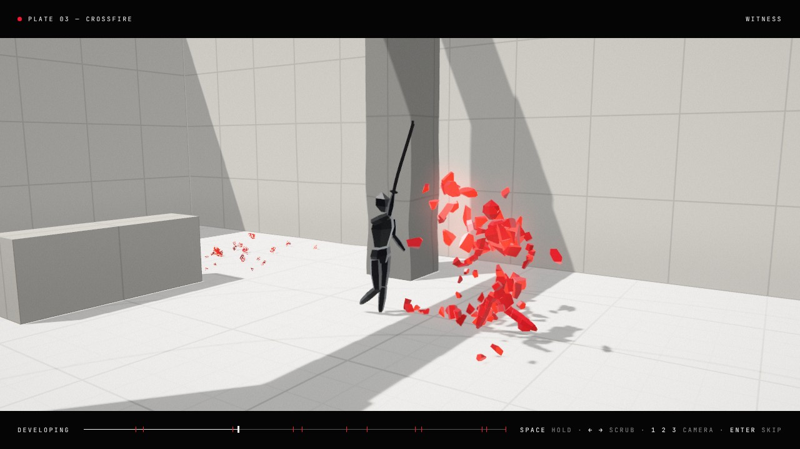

# STILLSHOT

> *time is not passed. it is spent.*

A browser-native temporal action game. The world only moves when you do — every step, every glance, every shot releases a little time, and time is the only thing you score.

TypeScript · three.js · Vite. No game engine and no art, audio or font files: every model, shader, animation and sound is generated in code.



| | |
| --- | --- |
|  |  |
|  |  |

More in [`docs/after/`](docs/after) (regenerate with `npm run capture`); the original build is in [`docs/before/`](docs/before).

---

## Run it

```bash
npm install
```

```bash
npm run dev
```

Then open <http://localhost:5173>. Needs a desktop browser with WebGL2, a keyboard and a mouse.

| Script | What it does |
| --- | --- |
| `npm run dev` | Dev server with hot reload |
| `npm run build` | Type-check, then production bundle in `dist/` |
| `npm run preview` | Serve the production bundle |
| `npm test` | Build, then run the regression suite (78 assertions, headless Chromium) |
| `npm run capture` | Regenerate the screenshots in `docs/after/` |

The test and capture scripts use Playwright. If it has no browser yet:

```bash
npx playwright install chromium
```

(or point `CHROME_EXE` at any Chrome/Chromium binary).

---

## Controls

| Input | Action |
| --- | --- |
| **W A S D** | Move — spends time |
| **Mouse** | Look — spends a little |
| **Left mouse** | Fire · strike · with empty hands, take what is under the crosshair |
| **Right mouse** / **Q** | Throw what you are holding |
| **E** | Take or catch |
| **F** | Strike with whatever is in hand |
| **Space** | Jump (you can mount waist-high cover). Hold while airborne to hang in slow time |
| **Shift** | Transfer into the figure under the crosshair |
| **C** (or **V**, middle mouse) | Borrow time |
| **R** | Expose the plate again |
| **Esc** | Pause |

During the replay: **Space** hold · **← →** scrub · **1 2 3** director / first person / pursuit · **Enter** skip.

Settings (title screen or pause): sensitivity, invert Y, field of view, three volume sliders, lens-effect strength, bloom, trajectory lines, render scale, **reduced motion**, **reduced flash**.

---

## The rules

1. **Time is spent.** The world's rate follows how much you are doing: `sqrt(move² + (0.55 · lookSpeed/4 rad·s⁻¹)²)`, shaped and smoothed. Stand still and it runs at 1/200.
2. **Every action costs time.** A shot, a swing, a throw, a grab each release a fixed slice. A gun only cycles on time you have spent — you cannot stand still and empty a magazine for free.
3. **One hit.** For you and for them.
4. **Rounds are objects.** They fly, they can be watched, side-stepped, blocked with anything thrown, split, or returned. A round that misses you keeps going and will kill whoever it finds.
5. **Nothing reloads.** A spent weapon is something to throw. Anything thrown knocks a weapon out of a hand; a weapon in the air belongs to whoever takes it.
6. **A blade splits.** Swing a katana into a round and it becomes two of yours, leaving along your aim. A bat sends it back whole — three times.
7. **Transfer** (Shift) puts you in another body. The one you leave breaks; what your new body was carrying is left hanging in front of you. Needs a line of sight.
8. **Borrowed time** (C) stops the world *completely* for up to 1.6 s while you keep moving. Then the world collects: for exactly as long as you held it, time runs at a full second per second whether you move or not. Rounds you fire during the loan hang at the muzzle and all leave together.

Things you can read without a HUD: red lines show where a figure is about to fire; dashed lines show where a slow round is going (the dashes crawl at the speed of time); rings on the floor spread from your feet at 2 m per world-second; the picture inverts to a negative while time is borrowed.

Your score for a plate is its **exposure** — the world-time it cost you. Less is better. Each plate has a par.

### Figures

| | |
| --- | --- |
| **Red** | Materialises (harmless for 0.75 s), fetches a weapon if it has none, stops and aims when it can see you, walks at you when it cannot. Will not shoot through a friend. In reach, a visible wind-up, then a committed swing. |
| **Constant** (amber, ringed) | Keeps its own time: never drops below 28 % speed however still you stand. You can hear it counting. Borrowed time stops it too. |
| **Bulwark** (white slab) | Rounds that hit the slab come back. Slow to turn. Anything thrown knocks the slab aside; a spike goes through it. |

### The plates

| # | Name | Idea |
| --- | --- | --- |
| 01 | First Light | Time moves when you move; rounds are objects |
| 02 | Glass House | You start with nothing: throw, disarm, catch |
| 03 | Crossfire | They are on both sides — let them shoot each other. The blade |
| 04 | Transposition | Three sealed rooms. The only door is another body |
| 05 | Borrowed Time | Opens on a wall of rounds with no gap |
| 06 | Metronome | Constants; a field where time pools and one where it will not wait |
| 07 | Slab | What you fire at the slab comes back |
| 08 | The Long Exposure | All of it |

---

## What is under it

```
src/
├─ core/      Game (state machine + loop), Time (the three clocks), Input, Settings, events
├─ config/    constants, palette, weapon table
├─ world/     Level (geometry, glass, pickups, time fields), Collision, the eight plates
├─ player/    Player (movement, actions, blade, transfer), Viewmodel
├─ combat/    Projectile, Throwable, Weapon
├─ ai/        Enemy (behaviour + pose), Director (waves, arrivals), Navigation (grid A*)
├─ fx/        Poly (convex polyhedra, Voronoi), Rig (articulated figures), Crystal + Shards
│             (GPU fracture), Streaks, Bullets, Env (surfaces, glass, fields), PostFX (lens), FX
├─ audio/     procedural Web Audio engine
├─ replay/    Recorder, Stage (playback), Cine (automatic cinematographer)
└─ ui/        HUD, Menu, styles
scripts/      harness, autoplayer, regression suite, perf probe, capture
docs/         NOTES.md (decisions, measurements, limits), before/ and after/ screenshots,
              blueprint.md (the original design brief, kept for history)
```

**Three clocks.** *Real* time drives the player's body. *Subjective* time is real time weighted by what the player is doing — it drives the player's weapon cooldowns. *World* time drives everything else and is normally the same as subjective time; borrowed time is the one place they are deliberately pulled apart. See `src/core/Time.ts`.

**Fracture.** Every body part is a convex polyhedron. The mesh you see and the shards it breaks into are generated from the same polyhedron by Voronoi decomposition, so a figure shatters into exactly the pieces of what was standing there. Each shard's flight (ballistic arc, one bounce, spin, a release delay that makes the crack travel outward from the hit) is a closed-form function of world time evaluated in the vertex shader — one draw call per burst, nothing integrated on the CPU. See `src/fx/Poly.ts`, `Shards.ts`, `Crystal.ts`.

**Replay.** A run is recorded as dense pose snapshots plus an event log (every effect with its seed, every sound, every kill and its cause) on a single timeline that combines world time with a compressed share of borrowed time. Playback re-poses the real rigs and feeds the recorded shatter specs back to the real shard system; because shard motion is a function of the clock, the replay shows the identical fracture and can be paused, scrubbed and restarted. An automatic cinematographer cuts between six kinds of shot and ramps speed around each kill. It never moves or invents anything — only where the camera stands. See `src/replay/`.

**Tests.** `window.__stillshot` exposes the game; `game.manual = true` hands the clock to the caller and `game.debugStep(dt, n)` advances exact frames, so tests choose the frame rate. The suite checks, among other things: look cost at 30/60/120/144/240 fps, no tunnelling at 20 fps, friendly fire, splitting, ricochets, disarm-and-catch, transfer line-of-sight, melee whiffs, Constants and fields, recording/playback fidelity, all eight plates completable by an autoplayer, determinism, no GPU-resource growth across retries, pause/resume and death/restart.

---

## Honest limits

- Tested by automation in headless Chromium only. **No human has playtested this build**, nobody has listened to the audio, and it has not been run on a physical GPU, in Firefox or in Safari. See `docs/NOTES.md` for exactly what was and was not verified.
- Keyboard and mouse only. No gamepad, touch or key remapping.
- The autoplayer proves plates *can* be finished; it does not prove they are well paced for a person. Pars are estimates.

## Attribution

STILLSHOT is a non-commercial fan project. It began as a study of the *time moves when you move* idea introduced by **SUPERHOT** (SUPERHOT Team), and still owes that game its central rule, one-hit kills, and the throw–disarm–catch loop. It uses none of SUPERHOT's assets, text, audio or branding. SUPERHOT is a trademark of the SUPERHOT Team. This is an educational project: nothing here has been cleared for commercial distribution, and the repository does not currently contain a licence file.
